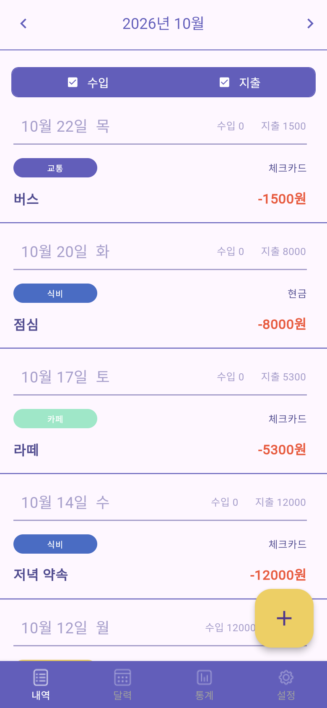
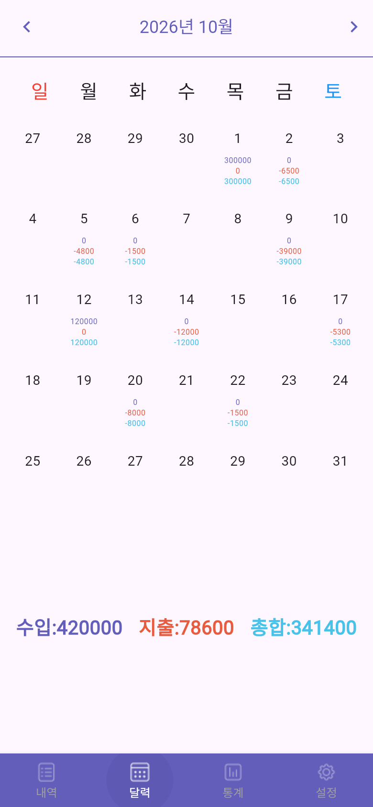
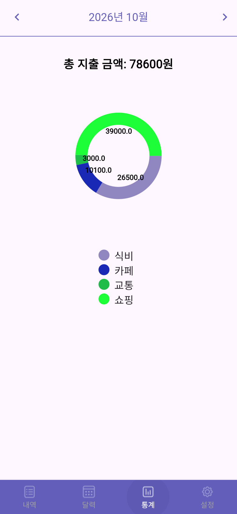
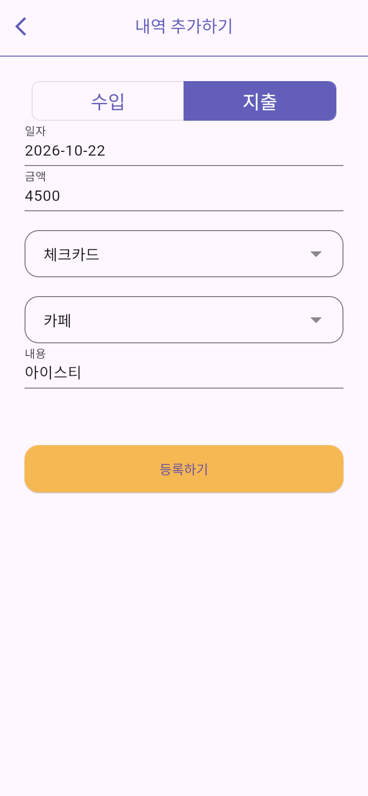
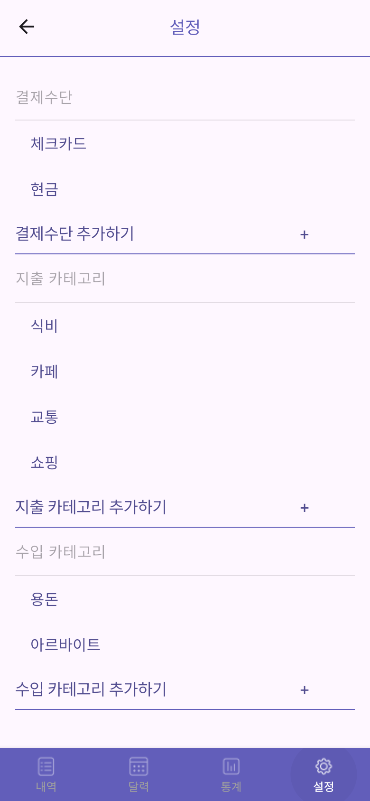
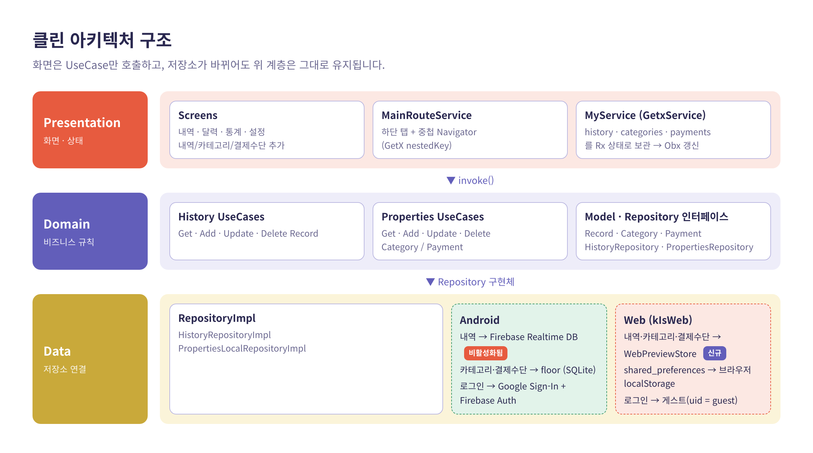
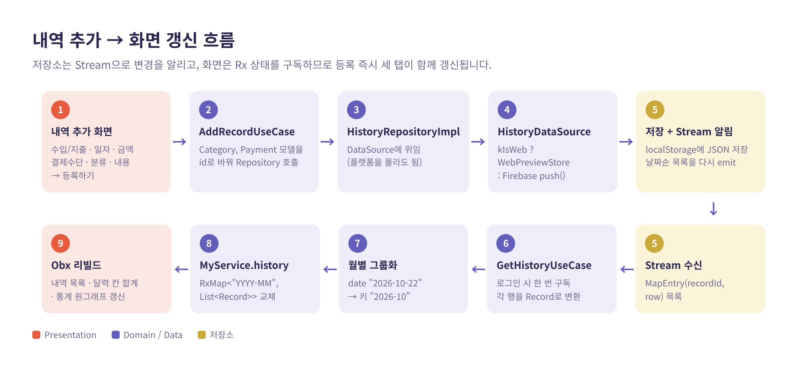
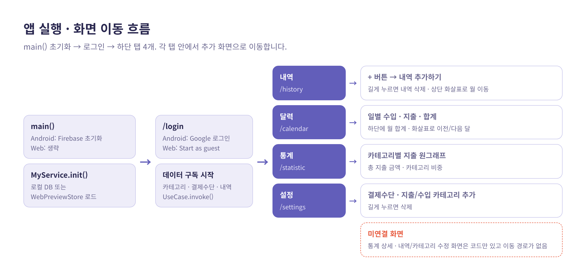

# 내돈어디가계 💸

> 대학생을 위한 **달력형 가계부** 앱 — 이번 달 돈이 *어디에* 쓰였는지 달력과 그래프로 한눈에 보여줍니다.

중앙대학교 모바일 앱 개발(01분반) 텀 프로젝트 · Flutter · Clean Architecture · GetX

<p align="center">
  
  
  
</p>

---

## 🚀 실행 방법

스마트폰이나 에뮬레이터 없이 **웹 브라우저에서 휴대폰 화면 크기로** 바로 실행할 수 있습니다.

### 1. 준비물
| 항목 | 버전 |
|---|---|
| Flutter | 3.47.8 (stable) 이상 |
| Dart | 3.13 이상 (Flutter에 포함) |
| 브라우저 | Chrome |

```bash
flutter --version   # Flutter 3.47.x / Dart 3.13.x 확인
```

### 2. 코드 받기 · 패키지 설치
```bash
git clone https://github.com/JUNGSEHOON-AutoML/flutter-budget-app.git
cd flutter-budget-app
flutter pub get
```

### 3. 실행
> ⚠️ 진입점은 `lib/main.dart`가 아니라 **`lib/presentation/login.dart`** 입니다. `-t` 옵션을 꼭 붙여주세요.

**내 컴퓨터에서 실행 (Chrome 자동 실행)**
```bash
flutter run -d chrome -t lib/presentation/login.dart
```

**원격 서버에서 실행하고 내 PC 브라우저로 보기**
```bash
# 서버에서
flutter run -d web-server --web-hostname 127.0.0.1 --web-port 8080 -t lib/presentation/login.dart

# 내 PC(PowerShell/터미널)에서 포트 연결 — 창을 닫지 마세요
ssh -L 8080:localhost:8080 <사용자>@<서버주소>
```
그다음 Chrome에서 `http://localhost:8080`을 엽니다.

### 4. 휴대폰 화면처럼 보기
1. Chrome에서 `F12` → `Ctrl + Shift + M` (기기 툴바)
2. 상단에서 **iPhone 12 Pro** 등 기기 선택 (390 × 844 기준으로 검증)
3. 첫 화면의 **Start as guest** 클릭 → 메인 화면 진입

| 동작 | 방법 |
|---|---|
| 코드 수정 후 바로 반영 | `flutter run` 터미널에서 `r` (Hot reload) / `R` (Hot restart) |
| 데이터 초기화 | 개발자도구 → Application → Local Storage → 항목 삭제 후 새로고침 |
| 배포용 빌드 | `flutter build web --release -t lib/presentation/login.dart` → `build/web/` |

> 💡 웹에서는 데이터가 브라우저(localStorage)에 저장됩니다. 처음 실행하면 내역은 비어 있고, 기본 카테고리(식비·카페·교통·쇼핑 / 용돈·아르바이트)와 결제수단(체크카드·현금)만 들어 있습니다.

---

## 📌 프로젝트 이야기 — Problem · Action · Result

### 🔴 Problem — 왜 이 문제가 중요한가

**① 서비스 관점: 대학생은 "얼마나"보다 "어디에" 썼는지 모른다**
- 코로나19 이후 대면 활동이 늘면서 대학생의 지출 상황이 급격히 늘었지만, 수입(용돈·아르바이트)은 한정적입니다.
- 카드 앱의 결제 목록은 **시간순 나열**이라 "이번 달 식비가 얼마인지", "어느 날 많이 썼는지"가 한눈에 보이지 않습니다.
- 목표: 소비에 대한 **경각심**을 주고, 달력·카테고리 통계로 **대안 소비**를 고민하게 만드는 가계부.

**② 기술 관점: 2022년에 만든 앱이 2026년에는 실행조차 되지 않았다**

| 문제 | 영향 |
|---|---|
| Firebase Realtime DB(`inkyeongbook-default-rtdb`) **비활성화** | 내역 저장·조회 기능 **전부 동작 불가** (기존 APK 포함) |
| Dart `>=2.18.4 <3.0.0` 제약 | 최신 Flutter(Dart 3)에서 `pub get`부터 실패 |
| 실기기 없음 · 서버에 KVM 권한 없음 | Android 에뮬레이터를 쓸 수 없어 **화면 확인 자체가 불가** |

### 🟡 Action — 대안 분석 및 실행

**대안 비교**

| 결정 사항 | 검토한 대안 | 선택 | 이유 |
|---|---|---|---|
| 실행 환경 | Android 에뮬레이터 | ❌ | KVM 가속 없이 소프트웨어 에뮬레이션은 실사용 불가 수준 |
| | 실기기에 APK 설치 | ❌ | 기기 없음 + 백엔드(DB)가 죽어 있어 의미 없음 |
| | **Flutter Web + Chrome 기기 모드** | ✅ | 같은 Dart 코드 그대로, 브라우저만 있으면 어디서나 확인 · Hot reload 지원 |
| 데이터 저장소 | 새 Firebase 프로젝트 생성 | ❌ | 콘솔 설정·키 교체·요금제 관리 필요, 데모 목적에 과함 |
| | sqflite 웹 버전 | ❌ | floor 생성 코드에 웹 SQLite(wasm·worker) 설정을 추가로 붙여야 함 |
| | **localStorage 어댑터 (`WebPreviewStore`)** | ✅ | 기존 Repository 인터페이스 유지, **DataSource 한 층만** 분기 |
| 로그인 | Google Sign-In (웹) | ❌ | 웹용 OAuth 클라이언트가 등록돼 있지 않음 |
| | **게스트 로그인** | ✅ | `uid = "guest"` 한 줄로 기존 흐름 그대로 진입 |
| 패키지 업그레이드 | 전부 최신 major | ❌ | `google_sign_in 7`, `dropdown_button2 3`은 API가 완전히 바뀜 |
| | **최신 + 호환 버전 고정 혼합** | ✅ | `google_sign_in 6.x`, `dropdown_button2 2.x`로 수정 범위 최소화 |

**실행 과정**
1. 작업 폴더에서 지워져 있던 소스(`lib/`, `web/`, `ios/` 등)를 git 이력에서 복구
2. Flutter 3.47.8 설치 → SDK 제약을 Dart 3으로 올리고 `flutter pub upgrade --major-versions`
3. 컴파일 에러를 하나씩 해결 (`ElevatedButton.styleFrom(primary→backgroundColor)`, fl_chart `SideTitleWidget(meta:)`, dropdown 2.x 스타일 API)
4. `kIsWeb` 분기로 Firebase 초기화 생략 · 데이터 저장소 교체 · 게스트 로그인 추가 (**Android 코드 경로는 그대로 유지**)
5. 헤드리스 Chrome(390×844)으로 4개 탭과 "내역 추가" 전체 흐름을 자동 클릭하며 화면 검증
6. 검증 중 발견한 기존 버그 수정 (기본 월이 2022년 12월로 고정, 달력 말일 계산이 2022년 11월로 고정)

### 🟢 Result — 수치로 본 성과

| 지표 | Before | After |
|---|---|---|
| 실행 가능 여부 | ❌ 빌드 실패 · DB 비활성화 | ✅ 웹에서 전 기능 동작 |
| Flutter / Dart | 3.3 / 2.18 | **3.47.8 / 3.13.7** |
| 의존 패키지 (pubspec.lock) | 102개 | 138개 (**139개 버전 갱신**) |
| 컴파일 에러 | 다수 (아래 API 변경) | **0개** |
| Breaking API 수정 | – | `styleFrom` **68곳**, fl_chart 1곳, Dropdown 2곳 |
| 변경 규모 (`lib`, `pubspec`) | – | **23개 파일**, +392 / −125줄 |
| UseCase 계층 변경 | – | 3개 파일은 **1줄씩** (`me.uid → uid`), `GetHistoryUseCase`만 Stream 형식 변경 |
| 웹 릴리스 빌드 | – | **42.5초**, `main.dart.js` **2.8 MB** |
| 화면 확인에 필요한 장비 | 안드로이드 기기 또는 에뮬레이터 | **브라우저 하나** |

> 클린 아키텍처 덕분에 저장소를 통째로 바꿨는데도 **화면(Presentation)과 UseCase(Domain)는 거의 수정하지 않았습니다.** 변경의 대부분은 Data 계층과 패키지 API 업데이트에 집중됐습니다.

---

## 📱 주요 기능

| 로그인 | 내역 | 내역 추가 |
|:---:|:---:|:---:|
|  |  |  |
| 웹에서는 게스트로 시작 | 월별 내역 · 수입/지출 필터 · 길게 눌러 삭제 | 수입/지출 · 일자 · 금액 · 결제수단 · 분류 · 내용 |

| 달력 | 통계 | 설정 |
|:---:|:---:|:---:|
|  |  |  |
| 일별 수입·지출·합계, 하단에 월 합계 | 카테고리별 지출 원그래프 · 총 지출 | 결제수단 · 지출/수입 카테고리 추가·삭제 |

- **월 이동**: 내역 · 달력 · 통계 상단의 `<` `>` 화살표
- **필수 입력**: 지출은 일자·금액·결제수단, 수입은 일자·금액

---

## 🧭 동작 로직

### 1. 클린 아키텍처 구조


- **Presentation**: 화면은 데이터를 직접 만지지 않고 UseCase만 호출합니다. 공용 상태는 `MyService`(GetxService)에 `Rx` 타입으로 들어 있어, 값이 바뀌면 `Obx`로 감싼 위젯이 자동으로 다시 그려집니다.
- **Domain**: `Record` · `Category` · `Payment` 모델과 Repository 인터페이스, 기능 단위 UseCase(`GetHistoryUseCase`, `AddRecordUseCase` …).
- **Data**: Repository 구현체가 DataSource에 위임합니다. **플랫폼 분기(`kIsWeb`)는 이 계층 안에서만** 일어납니다.

### 2. 내역 추가 → 화면 갱신 흐름


1. 사용자가 **등록하기**를 누르면 `AddRecordUseCase`가 실행됩니다.
2. `HistoryDataSource`가 웹이면 `WebPreviewStore`, Android면 Firebase에 저장합니다.
3. 저장소는 변경될 때마다 **날짜순 전체 목록을 Stream으로 다시 내보냅니다.**
4. 로그인 시 한 번 구독해 둔 `GetHistoryUseCase`가 각 행을 `Record`로 바꾸고 `"YYYY-MM"` 키로 묶어 `MyService.history`를 교체합니다.
5. 내역 목록 · 달력 칸 · 통계 그래프가 **동시에** 갱신됩니다. 화면끼리 서로를 알 필요가 없습니다.

### 3. 앱 실행 · 화면 이동 흐름


- `main()` → `MyService.init()`(로컬 저장소 준비) → `/login`
- 로그인에 성공하면 카테고리 · 결제수단 · 내역 구독을 시작하고 `/main`으로 이동합니다.
- `/main`은 하단 탭 4개를 **중첩 Navigator**(`Get.nestedKey(1)`)로 전환합니다. 탭을 바꿔도 하단 바는 그대로 유지됩니다.

---

## 🗂 프로젝트 구조

```
lib/
├── presentation/              # 화면 (Presentation)
│   ├── login.dart             # ★ 앱 진입점 main()
│   ├── main.dart              # 하단 탭 + 중첩 Navigator
│   ├── login/                 # 로그인 화면, Google 로그인 헬퍼
│   ├── history/               # 내역 탭
│   ├── canlendar/             # 달력 탭
│   ├── graph/                 # 통계 탭
│   └── setting/               # 설정 탭, 추가/수정 화면
├── application/               # 앱 전역 상태 (MyService, MainRouteService)
├── domain/                    # 모델 · Repository 인터페이스 · UseCase
└── data/
    ├── data_source/
    │   ├── history_remote_data_source.dart   # 내역: Firebase | Web
    │   ├── properties_local_data_source.dart # 카테고리·결제수단: floor | Web
    │   └── web_preview_store.dart            # 웹 전용 localStorage 저장소
    ├── repository_impl/
    ├── dao/ · entity/ · database/            # floor(SQLite) 정의
docs/images/                   # README 이미지
```

## 🛠 기술 스택

| 분류 | 사용 기술 |
|---|---|
| 프레임워크 | Flutter 3.47.8 · Dart 3.13 |
| 상태 관리 · DI · 라우팅 | GetX (`GetxService`, `Obx`, `Get.put`, Named route) |
| 아키텍처 | Clean Architecture (data · domain · presentation), MVVM |
| 로컬 DB | floor (SQLite) — Android / shared_preferences — Web |
| 원격 DB · 인증 | Firebase Realtime Database · Firebase Auth · Google Sign-In (Android) |
| 차트 | pie_chart, fl_chart |

---

## ⚠️ 알려진 이슈

- **Firebase Realtime DB 비활성화**: Android 빌드는 내역 저장/조회가 동작하지 않습니다. 웹에서는 `WebPreviewStore`로 대체됩니다.
- **같은 날 지출이 여러 건이면 달력 칸에는 한 건만 반영**됩니다. (내역 목록·통계 합계는 정상)
- **이동 경로가 없는 화면**: 통계 상세(`graphdetail_view.dart`), 내역·카테고리·결제수단 수정 화면(`update_history.dart`, `modify_*.dart`)은 코드만 있고 연결된 버튼이 없습니다.
- 설정 화면은 결제수단을 `payments[i + 1]`로 읽기 때문에 id가 1부터 연속이라고 가정합니다.

## 👥 팀

중앙대학교 모바일 앱 개발 01분반 (지도: 이준우 교수님) · 2022.11 – 2022.12

노현규 · 배인경 · 변영무 · 정세훈

2026.10 — 최신 Flutter 마이그레이션 및 웹 실행 환경 구성
